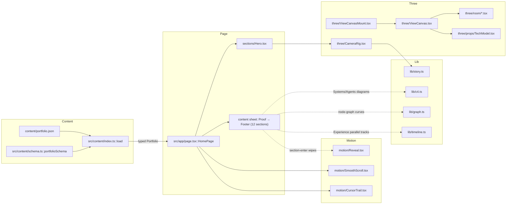

# Portfolio template — codebase map

Version: v1.0
Shape verdict: **static single-page app**. Evidence: `next.config.ts::output = 'export'`,
`src/app/page.tsx` (one route, `/`), no server actions, no API routes, no database.

## Mental model

This is a content-driven, single-page Next.js site. There is exactly one real "model": the
`Portfolio` shape defined in `src/content/schema.ts` (Zod). `src/app/page.tsx` renders thirteen
section components in a fixed order, each one handed its own typed slice of `content`. There is no
template-engine indirection beyond that — change `content/portfolio.json`, the typed data flows
straight into the section props, and a schema violation fails the build with a readable Zod error
instead of shipping a broken page.

The page is two visual layers: a sticky, scroll-driven 3D hero (`Hero` + `three/`) underneath, and a
rounded "content sheet" (everything from `Proof` down to `Footer`) that slides up over it as the user
scrolls. One shared WebGL canvas (`ViewCanvas` + `ViewCanvasMount`, via drei's `<View>`) serves every
small 3D tile on the page — section components never mount their own `<Canvas>`.

## Topology

Legend: solid = render-time data flow; dashed = a section component consuming a `lib/` helper for
layout math rather than raw content.

## Repository shape and inventory

Top-level domains: `src/` is all application code; `content/portfolio.json` is the **only** file a
person filling in their own data needs to touch; `public/` is static assets; `tests/` + `e2e/` are
Vitest/Playwright; `docs/` is this map plus the planning record (`../plans/`) and the design-system
artifacts (`../design/`) that preceded the code.

| Surface | Count | Notes |
|---|---:|---|
| Section components (`src/components/sections/`) | 12 | Rendered in `page.tsx` in the order: Hero, Proof, Lifecycle, Systems, Agents, Capabilities, CaseStudies, Experience, Leadership, Toolbox, Testimonials, Contact (+ `layout/Footer`, `layout/Navbar`) |
| Three.js components (`src/components/three/`) | 18 | Includes 11 procedural `room/*` pieces (`Shell`, `Window`, `Desk`, `Workstation`, `Lamp`, `NeonSign`, `Shelf`, `Plant`, `Chair`, `Atmosphere`, `Box`) |
| Motion components (`src/components/motion/`) | 6 | `Reveal`, `CountUp`, `CursorTrail`, `SmoothScroll`, `FlipWords`, `Marquee` |
| UI primitives (`src/components/ui/`) | 8 | `Button`, `Highlight`, `Icon`, `Media`, `Monogram`, `SectionHeading`, `Glow`, `HTrack` |
| `lib/` modules | 9 | `c4`, `graph`, `story`, `timeline`, `gsap`, `palette`, `utils`, `hooks/useReducedMotion` |
| Zod schema top-level keys (`src/content/schema.ts`) | 17 | `site`, `person`, `nav`, `hero`, `proof`, `lifecycle`, `systems`, `agents`, `capabilities`, `work`, `experience`, `leadership`, `toolbox`, `testimonials`, `contact`, `socials`, `footer` |
| Tests | 3 files | `tests/content.test.ts` (schema validation), `tests/story.test.ts`, `tests/timeline.test.ts`, plus `e2e/smoke.spec.ts` (Playwright) |

## Entry points

| Surface | Source | Notes |
|---|---|---|
| The one route | `src/app/page.tsx::HomePage` | No other routes exist — this is a single static page. |
| Content | `content/portfolio.json` → `src/content/index.ts::load` | Validated against `src/content/schema.ts::portfolioSchema` at import time; an invalid field throws with a path-qualified Zod message instead of rendering. |
| 3D mount point | `src/components/three/ViewCanvasMount.tsx` | Mounted once in `page.tsx`; every small 3D tile elsewhere on the page registers into this single shared canvas rather than creating its own. |
| Hero camera | `src/components/three/CameraRig.tsx` + `src/lib/story.ts::chapterOf` | Scroll position (0–1) maps to one of 4 "chapters" (`CHAPTER_BOUNDS`), which drives the camera path through the room. |

## Build & CI

- `next.config.ts`: `output: 'export'` — this is a fully static build (the `out/` folder), no
  Node server, deployable to Cloudflare Pages / Netlify / GitHub Pages / any static host.
- `.github/workflows/ci.yml`: on every push to `main` and every PR — `pnpm lint` →
  `pnpm typecheck` → `pnpm test` (Vitest) → `pnpm build`. No `test:e2e` (Playwright) step in
  CI yet — it's a local/manual script only (`pnpm test:e2e`).
- Package manager is **pnpm** via `corepack enable` (see root `README.md`), not npm.

## For anyone cloning this template

The only file you need to edit is `content/portfolio.json` — see the root `README.md` for the
full field-by-field guide. Everything in this map describes *how the template renders your data*,
not anything you need to change by hand.
